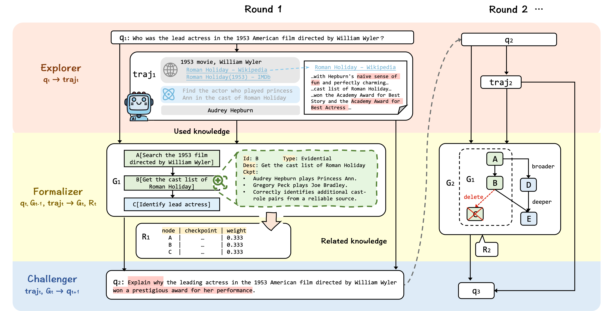
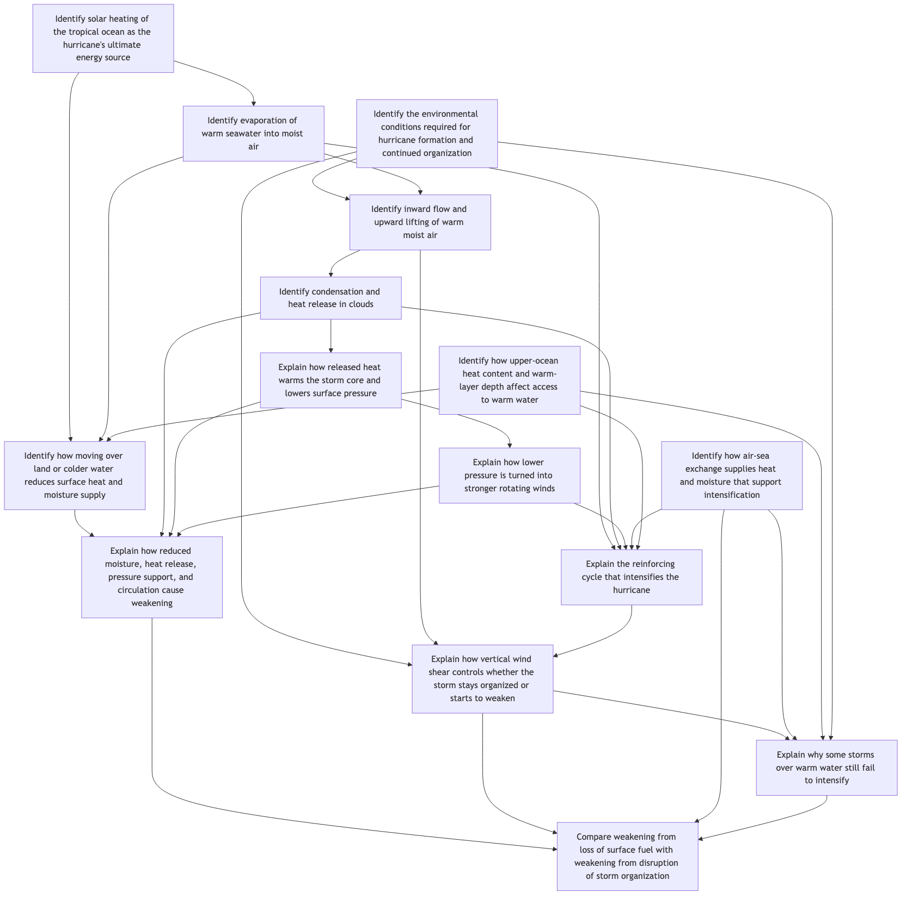

<div align="right">

[English](README.md) | 简体中文

</div>

<div align="center">

# TaskEvolving

**面向 Agentic Deep Research 的任务自动演化 (Task Evolution) 与 Agentic RL 训练一体化仓库**

</div>

TaskEvolving 是一个端到端的代码仓库，覆盖 Deep Research 智能体研发中最关键的两个环节：

1. **数据合成（Task Evolution）**：从简单问答（QA）出发，通过多智能体协作的迭代式任务演化，自动生成具备专业深度、可验证 rubric 的 Deep Research 任务（`deep_research/synthesis_v2`）。
2. **Agentic RL 训练**：基于 [verl](https://github.com/verl-project/verl) 的多轮工具调用（Multi-Turn Tool Use）强化学习训练框架，配合基于 rubric 的过程奖励（Process Reward），训练模型解决 Deep Research 任务（`deep_research/reward`、`deep_research/dr_*.py`）。

两部分共享同一套任务表示：每个任务被建模为一个由原子步骤（evidential / analytical）组成的**有向无环图（DAG）**，图上每个节点都带有可独立验证的 checkpoint，并据此推导出按图结构加权的 rubric。这套表示既是数据合成阶段的产物，也是训练阶段奖励计算的直接输入，使"任务构造"与"任务求解"共享同一个可验证的评价标准。

## 目录

- [整体架构](#整体架构)
- [仓库结构](#仓库结构)
- [环境准备](#环境准备)
- [数据合成：Task Evolution](#数据合成task-evolution)
- [Agentic RL 训练](#agentic-rl-训练)
- [实验与分析脚本](#实验与分析脚本)
- [verl 二次开发原则](#verl-二次开发原则)
- [License](#license)

## 整体架构

数据合成部分实现了一个 **Explorer–Formalizer–Challenger** 循环，每一轮迭代都会让任务变得更难，同时保持逻辑连贯与可解性：

- **Explorer**：在真实工具环境（搜索、网页浏览等）中对当前 query 进行一次 rollout，产出探索轨迹 `traj`。
- **Formalizer**：将轨迹中与任务相关的信息整理为 DAG（节点为原子研究步骤，边表示逻辑依赖），并从 DAG 自底向上（叶子节点开始）推导出按结构加权的 rubric；每个节点的 checkpoint 均可独立核验。
- **Challenger**：从已探索但尚未纳入任务图的信息中，挑选与当前任务逻辑相关的线索，生成下一轮更难的 query——既可以在广度上引入新的研究维度，也可以在深度上拉长推理/检索链路。

当 DAG 的节点数与深度连续两轮保持不变时，迭代自动收敛并停止，从而避免无限演化。

<p align="center">
  
</p>

每一次演化都会持续把新发现的知识（人物关系、时间线、跨来源的事实关联等）沉淀进任务图，最终形成的 DAG 往往具有较高的节点数与深度，下图是一个真实演化结果的示例（节点为原子研究步骤，边为逻辑依赖）：

<p align="center">
  
</p>

Agentic RL 训练部分复用同一套 DAG/rubric 表示：训练时的奖励函数（`deep_research/reward/openjudge_reward_function.py`）基于 [OpenJudge](https://github.com/agentscope-ai/OpenJudge) 的 rubric 评测器，对模型生成的多轮工具调用轨迹逐条 checkpoint 打分并按权重汇总，作为 PPO/GRPO 等算法的过程奖励信号。

## 仓库结构

```text
TaskEvolving/
├── deep_research/
│   ├── synthesis_v2/            # 数据合成：Task Evolution 主链路
│   │   ├── complexity_exploration/  # Explorer-Formalizer-Challenger 编排器与 Reviser
│   │   ├── query_generation/        # 从语料生成初始 seed query
│   │   ├── workflow/                # Query→Trajectory 的工作流与适配器
│   │   ├── core/                    # Pipeline、批处理、LLM 调度、数据结构等基础设施
│   │   ├── evaluate/                # 基于 OpenJudge 的轨迹评估器
│   │   ├── mermaid/                 # DAG 的 Mermaid 结构化表示与解析
│   │   ├── prompts/                 # Explorer/Formalizer/Challenger 各阶段 Prompt
│   │   ├── config/                  # synthesis_v2 运行配置（yaml）
│   │   └── experiments/             # 数据合成批量运行入口脚本
│   ├── reward/                   # 训练奖励：基于 OpenJudge 的 rubric reward function/manager
│   ├── tool/                     # 搜索/网页抓取等工具的测试与封装
│   ├── config/                   # verl 训练所需的 tool_config 等配置
│   ├── dr_ray_trainer.py         # 继承 verl RayPPOTrainer 的定制训练器
│   ├── dr_completion_callback.py # 多轮工具调用的 completion callback
│   ├── dr_chat_scheduler_no_thinking.py  # 定制 chat scheduler
│   └── run_qwen3_async_mt_dr.sh  # 训练启动脚本示例
├── experiment/                   # 数据分析、可视化与评测复现脚本
├── patches/verl/                 # verl 定制补丁（不直接提交进 submodule）
├── natural-questions/            # [submodule] 种子 QA 语料（NQ-Open）
├── OpenJudge/                    # [submodule] Rubric 评测 / Grader 框架
├── verl/                         # [submodule] Agentic RL 训练框架
└── requirements.txt
```

## 环境准备

### 克隆仓库与外部依赖

本仓库通过 Git submodule 引入三个外部仓库，版本由主仓库中的 gitlink commit 精确锁定：

| 路径 | 来源 | 锁定版本 |
| --- | --- | --- |
| `natural-questions` | `google-research-datasets/natural-questions` | `fb26a307` |
| `OpenJudge` | `agentscope-ai/OpenJudge` | `v0.2.2` (`33db7c4a`) |
| `verl` | `verl-project/verl` | `v0.4.1` (`8d9e350e`) |

新克隆（`$TASK_EVOLVING_REPO` 替换为实际 Git URL）：

```bash
git clone --recurse-submodules "$TASK_EVOLVING_REPO"
cd TaskEvolving
```

已有工作区初始化：

```bash
git submodule update --init --recursive --depth 1
```

### 应用 verl 定制补丁

初始化 submodule 后，在主仓库根目录执行：

```bash
git -C verl apply --ignore-space-change --check ../patches/verl/task-evolving-customizations.patch
git -C verl apply --ignore-space-change ../patches/verl/task-evolving-customizations.patch
```

应用补丁后，`verl` submodule 会显示为包含未提交修改（dirty）——这是预期状态，无需在 submodule 内部提交这些改动。

<details>
<summary>更新 submodule / 更新 verl（含补丁逆向与重应用）</summary>

**更新 `natural-questions` / `OpenJudge`**（以 tag 更新，`<new-tag>` 替换为目标 tag，如 `v0.2.3`）：

```bash
cd OpenJudge  # 或 natural-questions
git fetch origin tag <new-tag>
git checkout <new-tag>
cd ..
git add OpenJudge
git commit -m "chore: bump OpenJudge to <new-tag>"
```

`git fetch origin tag <new-tag>` 仅获取该 tag 指向的 commit；若需锁定未打 tag 的 commit，请显式 fetch 对应 ref（如 `git fetch origin refs/heads/<branch>` 或完整 SHA），再 `git checkout <full-commit-sha>`。

**更新 `verl`**（`verl` 应用定制补丁后为 dirty 状态，更新前必须先逆向移除补丁，checkout 干净上游后再检查并重应用补丁；以下命令均从主仓库根目录执行，`<new-tag>` 替换为目标 tag，如 `v0.4.2`）：

```bash
PATCH=patches/verl/task-evolving-customizations.patch

# 1. 确认补丁已应用，并逆向移除（使 verl 回到锁定 commit 的干净树）
git -C verl apply --ignore-space-change --reverse --check "../${PATCH}"
git -C verl apply --ignore-space-change --reverse "../${PATCH}"

# 2. 获取并 checkout 新 tag
git -C verl fetch origin tag <new-tag>
git -C verl checkout <new-tag>

# 3. 检查补丁是否仍适用于新版本；--check 失败则须先调整补丁，禁止强制 apply
git -C verl apply --ignore-space-change --check "../${PATCH}"
git -C verl apply --ignore-space-change "../${PATCH}"

# 4. 在主仓库提交新的 gitlink
git add verl
git commit -m "chore: bump verl to <new-tag>"
```

若第 3 步 `git apply --check` 失败，说明补丁与新版本不兼容，须先在主仓库修订补丁使其通过 `--check` 后再重新 apply；不要用 `git apply --reject`、`git checkout -- .` 或 `git reset --hard` 等方式强行覆盖。

**长期定制**：不要在 submodule 目录内直接提交长期定制代码。如需持续修改上游项目，应 fork 对应仓库并在 `.gitmodules` 中指向你的 fork，或将定制逻辑保留在主仓库（如 `patches/verl/` 下的补丁文件）。

</details>

### 安装依赖

```bash
pip install -r requirements.txt
```

`verl` 依赖（二选一）：

```bash
# 方案 1
pip install -r verl/requirements_sglang.txt && \
pip install vllm==0.8.4 && \
cd verl && pip install -e . && cd ..

# 方案 2（避免 vllm 0.8.5 与 torch/torchvision 版本不一致的一系列问题，
# 修改 verl/setup.py 中的 vllm==0.8.4 后）
cd verl && pip install -e .[vllm] && cd ..
```

如遇 `flash-attn` 安装问题：

```bash
conda install -c conda-forge flash-attn
# 若 conda 装不上：
pip install flash-attn --no-build-isolation
```

`atomic_eval` 与 `berkeley-function-call-leaderboard`（Bfcl）不在本仓库内，需另行 clone 后设置路径环境变量：

```bash
export GORILLA_BFCLEADERBOARD_PATH=/path/to/gorilla/berkeley-function-call-leaderboard
export ATOMIC_EVAL_PATH=/path/to/atomic_eval

pip install -e "$GORILLA_BFCLEADERBOARD_PATH"
pip install -e "$ATOMIC_EVAL_PATH"
```

## 数据合成：Task Evolution

数据合成主链路位于 `deep_research/synthesis_v2`，核心配置为 `deep_research/synthesis_v2/config/synthesis_v2.yaml`（模型、并发、rubric 评测、探索轮数上限等均在此配置）。

对一批 seed query 批量运行任务演化：

```bash
python deep_research/synthesis_v2/experiments/run_complexity_exploration_on_seed_file.py \
  --language en

# 限制并发探索数量 + 只跑前 20 条 seed
python deep_research/synthesis_v2/experiments/run_complexity_exploration_on_seed_file.py \
  --max-concurrent-seeds 3 \
  --limit 20

# 显式指定 seed 文件（覆盖语言默认数据集）
python deep_research/synthesis_v2/experiments/run_complexity_exploration_on_seed_file.py \
  --input deep_research/synthesis_v2/data/nq_ch.jsonl \
  --language cn

# 断点续跑：非正常结束（触顶 max_iterations / 报错 / 进程中断等）
# 会从 iterations.json 记录的检查点继续，而不是重新跑
python deep_research/synthesis_v2/experiments/run_complexity_exploration_on_seed_file.py \
  --resume \
  --max-concurrent-seeds 2
```

每条 seed 的演化过程会落盘到 `outputs/complexity_exploration/<query_id>/`，其中：

- `iterations.json`：每一轮实际使用的 query、DAG（Mermaid 表示）、rubric 的汇总记录，用于复盘与断点续跑。
- `traj_<iteration_id>.jsonl`：该轮 Explorer 产出的完整探索轨迹（工具调用与返回）。
- `reviser.json`：Formalizer/Challenger 每一轮的输入输出记录，便于排查 DAG 演化的中间过程。

API Key 通过环境变量注入：rubric 评测优先读取 `DASHSCOPE_API_KEY`（回退 `OPENAI_API_KEY`），其余环节（探索、轨迹生成等）优先读取 `OPENAI_API_KEY`（回退 `DASHSCOPE_API_KEY`）。

## Agentic RL 训练

训练任务的 workdir 应为主仓库根目录，`verl` 以 `pip install -e .` 安装为 editable package。训练通过以下自定义组件与 verl 集成：

| 组件 | 作用 |
| --- | --- |
| `deep_research/dr_ray_trainer.py` | 继承 `verl.trainer.ppo.ray_trainer.RayPPOTrainer` 的定制训练器 |
| `deep_research/dr_completion_callback.py` | 多轮工具调用的 `CompletionCallback`，负责解析 tool call 并调度工具执行 |
| `deep_research/dr_chat_scheduler_no_thinking.py` | 定制的异步 chat scheduler |
| `deep_research/reward/openjudge_reward_function.py` | 基于 OpenJudge Grader 的 rubric reward function（`compute_score_async`） |
| `deep_research/reward/openjudge_reward_manager.py` | 与 verl `DataProto` 对接的 reward manager |

启动示例（`deep_research/run_qwen3_async_mt_dr.sh`，GRPO + 多轮工具调用 + vLLM 异步 rollout）：

```bash
bash deep_research/run_qwen3_async_mt_dr.sh
```

脚本关键配置项包括：`custom_reward_function.path/name` 指向上表中的 rubric reward function，`actor_rollout_ref.rollout.multi_turn.completion_callback/chat_scheduler_class_name` 指向定制的多轮工具调用组件，`+trainer.custom_class_path` 指向定制训练器。工具配置（搜索引擎、网页抓取等）见 `deep_research/config/tool_config/`。

## 实验与分析脚本

`experiment/` 目录提供了一系列用于分析数据合成质量与模型评测结果的脚本，包括：任务演化轮次/DAG 规模统计、按迭代轮次的模型得分曲线、rubric 打分分布、评测结果的批量导出与翻译等。这些脚本可作为复现数据分析、扩展评测维度的参考实现。

## verl 二次开发原则

尽可能最小改动 verl 源码，避免以后合并最新 verl 代码时频繁解决冲突：

- 新特性优先以 customize class 的方式接入（如自定义 Trainer / RewardManager / CompletionCallback，均通过继承实现）。
- 若 verl 源码本身不支持 customize，才对源码做最小侵入式修改（例如 `reward.py` 中仅新增几行以支持自定义 reward manager 的注入点）。
- `main_ppo.py`、`ray_trainer.py` 等上层入口如需修改，优先考虑继承原 class 并直接调用，而非直接改动源文件。
- 长期维护的定制统一通过 fork 或 `patches/verl/` 下的补丁文件管理，不在 submodule 内部提交定制代码。

## License

本仓库采用 [Apache License 2.0](LICENSE)。三个 submodule（`natural-questions`、`OpenJudge`、`verl`）分别遵循各自上游仓库的许可协议。
