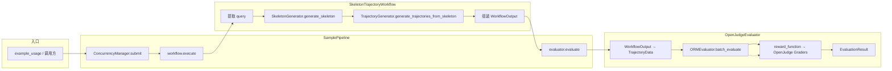
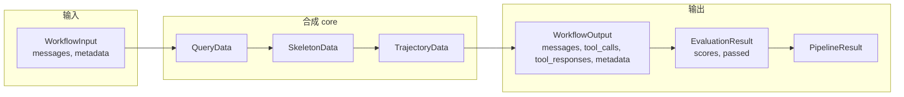
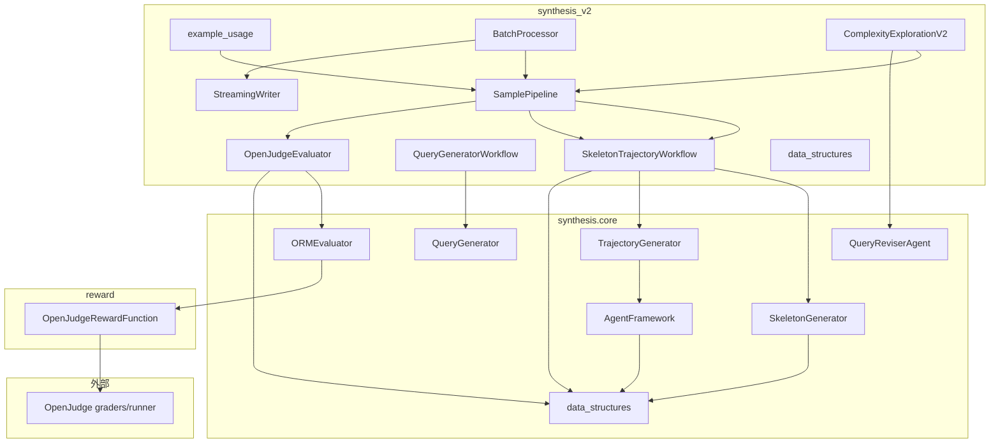

# Synthesis V2：代码依赖与流程说明

本文档描述当前项目中 **synthesis_v2** 与 **deep_research.synthesis**、**reward**、**OpenJudge** 之间的依赖关系和数据/控制流程，便于后续扩展（如 Mermaid 业务逻辑）时定位修改点。

---

## 一、模块依赖关系（谁依赖谁）

### 1. 顶层入口与配置

- **入口**：`deep_research/synthesis_v2/example_usage.py`
  - 加载配置：`synthesis_v2/config/synthesis_v2.yaml`（OmegaConf）
  - 依赖：`synthesis_v2.core`（ConcurrencyManager, WorkflowInput, SamplePipeline, BatchProcessor）、`synthesis_v2.workflow.native`、`synthesis_v2.evaluate`、`synthesis_v2.io`

- **配置**：`synthesis_v2/config/synthesis_v2.yaml`
  - 被所有 synthesis_v2 组件以及传入的 `deep_research.synthesis.core`、`deep_research.reward` 使用（整份 config 向下传递）

### 2. synthesis_v2 包内部

```
synthesis_v2/
├── example_usage.py          # 入口，不依赖同包其他业务模块（仅 import）
├── core/
│   ├── data_structures.py    # WorkflowInput, WorkflowOutput, EvaluationResult, PipelineResult（无外部依赖）
│   ├── concurrency.py       # ConcurrencyManager（无外部依赖）
│   ├── pipeline.py          # SamplePipeline → 依赖 workflow.base, evaluate.base, core.data_structures
│   └── batch_processor.py   # BatchProcessor → 依赖 pipeline, io.streaming_writer
├── workflow/
│   ├── base.py              # WorkflowBase 抽象（无外部依赖）
│   └── native/
│       └── skeleton_trajectory_workflow.py  # 依赖 synthesis_v2.core.data_structures + deep_research.synthesis.core（SkeletonGenerator, TrajectoryGenerator, QueryData）
├── evaluate/
│   ├── base.py              # EvaluatorBase 抽象
│   └── openjudge_evaluator.py  # 依赖 synthesis_v2.core.data_structures + deep_research.synthesis.core.orm_evaluator, TrajectoryData
├── io/
│   └── streaming_writer.py  # 依赖 core.data_structures.PipelineResult
├── query_generation/
│   └── query_workflow.py    # 依赖 workflow.base, core.data_structures, deep_research.synthesis.core.query_generator
└── complexity_exploration/
    └── orchestrator.py       # ComplexityExplorationV2，依赖 core.pipeline, core.data_structures, synthesis.core（QueryData, QueryEvolution, IterationData, QueryReviserAgent）
```

### 3. synthesis_v2 → deep_research.synthesis.core

| synthesis_v2 组件 | 调用的 synthesis.core 模块 |
|-------------------|----------------------------|
| SkeletonTrajectoryWorkflow | SkeletonGenerator, TrajectoryGenerator, QueryData |
| OpenJudgeEvaluator | ORMEvaluator, TrajectoryData（及 ToolCall/ToolResponse 等） |
| QueryGeneratorWorkflow | QueryGenerator |
| ComplexityExplorationV2 | QueryData, QueryEvolution, IterationData, QueryReviserAgent |

### 4. deep_research.synthesis.core 内部

```
synthesis/core/
├── data_structures.py       # QueryData, SkeletonData, TrajectoryData, RubricsData, ToolCall, ToolResponse, EvaluationResult 等（无外部业务依赖）
├── skeleton_generator.py   # 依赖 data_structures, structured_llm_client
├── trajectory_generator.py # 依赖 data_structures, agent_framework
├── agent_framework.py      # 依赖 data_structures, conversation_manager（OaiConversationManager）
├── conversation_manager.py # 依赖 data_structures（SkeletonData）, 配置
├── structured_llm_client.py# 依赖 config, openai, pydantic
├── orm_evaluator.py        # 依赖 data_structures（TrajectoryData, EvaluationResult）, 动态加载 reward_function（如 openjudge_reward_function）
├── query_generator.py      # 依赖 data_structures（QueryData）, structured_llm_client, utils.tool_loader, prompts
├── query_reviser.py        # 依赖 data_structures（QueryData, TrajectoryData, RubricsData, ToolResponse）, structured_llm_client, prompts
└── ...                     # 其他（data_synthesis_pipeline, complexity_exploration_orchestrator 等为旧/并行入口）
```

### 5. 评估与 Reward 链路

```
ORMEvaluator (synthesis/core/orm_evaluator.py)
  → 从 config.reward_function 动态 import 并实例化（如 OpenJudgeRewardFunction）
  → 将 TrajectoryData 转成 RewardSample（messages + extra 中含 rubrics）
  → 调用 reward_function(prompt_to_samples) → OpenJudge GradingRunner

deep_research/reward/openjudge_reward_function.py
  → OpenJudgeRewardFunction 使用 OpenJudge 的 Graders（financial_*, trajectory_comprehensive, rubrics_based_trajectory_performance, observation_information_gain, action_loop_detection）
  → 依赖 openjudge 包（graders, runner, models）
```

### 6. 配置使用方（简要）

| 配置路径 | 使用方 |
|----------|--------|
| concurrency.max_workers | example_usage → ConcurrencyManager |
| writer.output_dir | example_usage, StreamingWriter |
| batch_processor.* | BatchProcessor |
| openai_api.* | 多处（ORMEvaluator 透传到 reward init_params）、StructuredLLMClient、OaiConversationManager 等 |
| multi_turn.* | AgentFramework, ConversationManager |
| skeleton.* | SkeletonGenerator |
| generation.* | TrajectoryGenerator |
| query_generation.* | QueryGenerator |
| orm.*, reward_function.*, quality_control.* | ORMEvaluator |
| complexity_exploration.* | ComplexityExplorationV2 |

---

## 二、数据流与核心流程

### 1. 单条样本 Pipeline（example_single_sample / pipeline.process）

```
WorkflowInput(messages, metadata)
    → SamplePipeline.process(input)
        → ConcurrencyManager.submit(workflow.execute(input))
            → SkeletonTrajectoryWorkflow.execute(input)
                → 从 messages 提取 query → QueryData
                → SkeletonGenerator.generate_skeleton(query_data) → SkeletonData
                → TrajectoryGenerator.generate_trajectories_from_skeleton(skeleton, n=1) → [TrajectoryData]
                → 取 trajectories[0] 转为 WorkflowOutput(messages, tool_calls, tool_responses, final_response, metadata)
        → OpenJudgeEvaluator.evaluate(workflow_output, input.metadata)
            → _convert_to_trajectory(workflow_output, context) → TrajectoryData
            → ORMEvaluator.batch_evaluate([trajectory])
                → _prepare_trajectories_as_reward_samples → RewardSample（含 extra.rubrics）
                → reward_function(prompt_to_samples) → OpenJudge 各 grader 打分
                → 汇总为 orm_scores, passed_quality_check
            → 转为 EvaluationResult(trajectory_id, scores, details, passed)
        → PipelineResult(input, output, evaluation, timestamp)
    → 可写入 single_results.jsonl
```

### 2. 批处理 + Best of N（example_batch_processing）

```
List[WorkflowInput]
    → BatchProcessor.process_all(inputs)
        → 按 batch_size 分批 → process_batch(batch_inputs)
            → 若 best_of_n>1：_expand_inputs_for_best_of_n（复制每输入 n 份，带 sample_index / original_input_id）
            → asyncio.gather(pipeline.process(inp) for inp in expanded) → List[PipelineResult]
            → StreamingWriter.append_results(valid_results) → pipeline_results.jsonl
            → 若 best_of_n>1：_apply_rejection_sampling（按 original_input_id 分组，选 evaluation.score 最高）
                → append_selected_result / append_rejected_result → selected_results.jsonl, rejected_results.jsonl
        → writer.save_summary(...) → summary.json
    → List[PipelineResult]（每输入一条时为选中结果）
```

### 3. Query 生成（example_query_generation）

```
WorkflowInput(messages=[], metadata={num_queries: N})
    → QueryGeneratorWorkflow.execute(input)
        → QueryGenerator.generate_queries(num_queries) → List[QueryData]（或等价结构）
        → 转为 WorkflowOutput(messages=[{role:assistant, content: q.content}], metadata={queries, num_generated})
    → 示例中再写入 queries.jsonl
```

### 4. 复杂度探索（ComplexityExplorationV2.explore，当前 v2 编排器）

```
QueryData seed_query
    → 循环 max_iterations:
        → 若有 previous_rubrics：写入 workflow_input.metadata['rubrics']
        → pipeline.process(workflow_input) → PipelineResult（内含 skeleton→trajectory→evaluation）
        → quality_score = result.evaluation.score
        → 记录 IterationData，append 到 evolution.iterations
        → _should_continue_exploration(quality_score, iteration_id, evolution) → 是否继续
        → 若继续：query_reviser.revise_query(current_query, trajectory, quality_score, iteration_id) → (complex_query, rubrics)
        → 当前 v2 编排器此处为 TODO，未真正调用 reviser，直接 break
        → 否则：previous_rubrics = rubrics，current_query = complex_query，下一轮
    → 返回 QueryEvolution(original_query, iterations, ...)
```

注意：`deep_research.synthesis.core.complexity_exploration_orchestrator` 中已有完整“reviser 生成新 query + rubrics、下一轮带入 rubrics”的闭环；synthesis_v2 的 `ComplexityExplorationV2` 仍为“占位 + TODO”，未接上该 reviser。

---

## 三、Mermaid 流程图（可直接放入文档或 Mermaid 渲染器）

### 1. 单条样本 Pipeline 控制流



### 2. 单条样本数据流（结构）



### 3. 模块依赖总览（包级）



### 4. 批处理 + Best of N 流程

```mermaid
flowchart TB
    A[List[WorkflowInput]] --> B[BatchProcessor.process_all]
    B --> C{按 batch_size 分批}
    C --> D[process_batch]
    D --> E{best_of_n > 1?}
    E -->|是| F[扩展输入 n 份]
    E -->|否| G[直接 pipeline.process 每条]
    F --> G
    G --> H[StreamingWriter.append_results]
    H --> I{best_of_n > 1?}
    I -->|是| J[按 original_input_id 分组]
    J --> K[每组选 score 最高]
    K --> L[append_selected / append_rejected]
    I -->|否| M[返回本批结果]
    L --> M
    M --> N[下一批或 save_summary]
```

---

## 四、关键文件与修改时关注点

| 需求 | 主要涉及位置 |
|------|----------------|
| 改单条 pipeline 行为 | `synthesis_v2/core/pipeline.py`，`workflow/native/skeleton_trajectory_workflow.py` |
| 改 skeleton / trajectory 生成 | `synthesis/core/skeleton_generator.py`，`trajectory_generator.py`，`agent_framework.py` |
| 改评估逻辑或接入新 grader | `synthesis/core/orm_evaluator.py`，`reward/openjudge_reward_function.py`（create_grader_configs） |
| 改 rubrics 传递与使用 | `orm_evaluator._prepare_trajectories_as_reward_samples`（extra.rubrics），OpenJudgeEvaluator 的 context，workflow 的 metadata |
| 接上复杂度探索 + reviser | `synthesis_v2/complexity_exploration/orchestrator.py`（实现 TODO：调用 query_reviser，更新 current_query / previous_rubrics） |
| 增加 Mermaid 业务逻辑 | 建议新模块（如 synthesis_v2/business_logic 或 synthesis/core/business_logic），在 trajectory 产出后调用；exploration 编排处调用 expander 再调 reviser |

以上即为当前项目的依赖关系与主流程说明；所有 Mermaid 图可直接复制到支持 Mermaid 的 Markdown 或文档系统中渲染。
